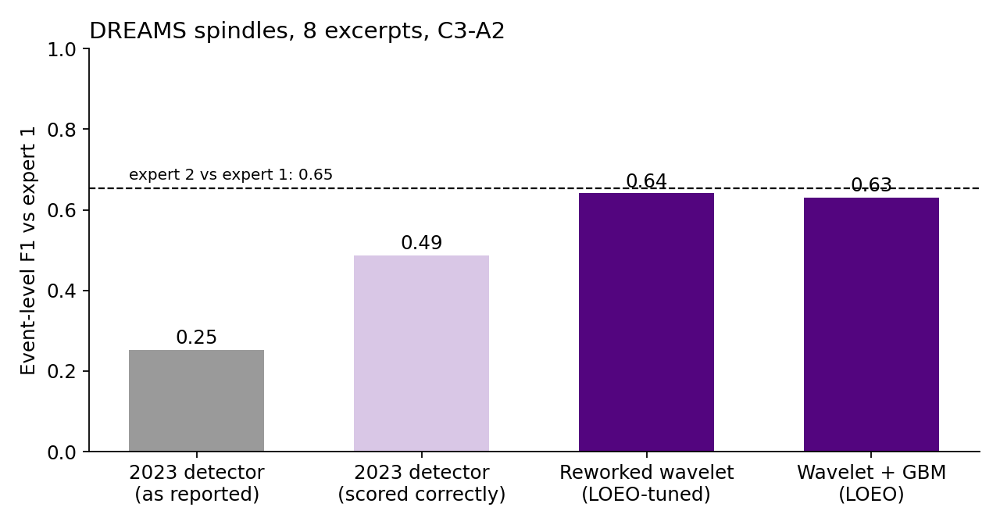
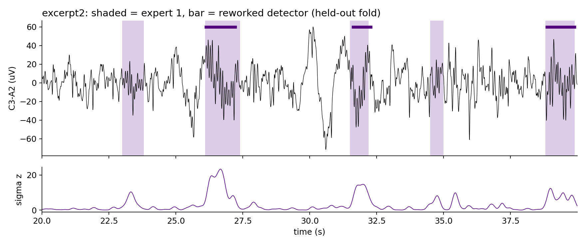

# Sleep spindle detection on single-channel EEG

Automatic detection of sleep spindles (11-16 Hz bursts, 0.5-3 s) on the C3-A2 channel of the
[DREAMS Sleep Spindles database](https://zenodo.org/records/2650142), scored event by event against
two human experts.

The project began in October 2023 as a four-person team project in the M.Sc. Medical Engineering &
eHealth programme at FH Technikum Wien. In 2026 I revisited it. The main finding is that the
original detector was much better than our report said: the evaluation code was wrong, not the
detector. After fixing the evaluation, I reworked the detector and tested it with leave-one-excerpt-out
cross-validation.



## Results

Event-level scores against expert 1, all 8 excerpts. For each excerpt, any tuned parameter was
chosen on the other 7 excerpts only (leave-one-excerpt-out, LOEO).

| Method | Precision | Recall | F1 vs expert 1 | F1 vs expert 2 |
|---|---|---|---|---|
| 2023 detector, F1 as originally reported (test split) | | | 0.25 | 0.28 |
| 2023 detector, unchanged, scored correctly | 0.46 | 0.52 | 0.49 | 0.50 |
| **Reworked wavelet detector (LOEO)** | **0.70** | **0.59** | **0.64** | **0.65** |
| Reworked detector + gradient-boosted re-scoring (LOEO) | 0.59 | 0.67 | 0.63 | 0.60 |
| Expert 2 vs expert 1 (excerpts 1-6, first 1000 s) | 0.81 | 0.55 | 0.65 | |

Read this as: the reworked detector agrees with expert 1 about as well as the two experts agree
with each other. Per-excerpt F1 ranges from 0.37 (excerpt 4) to 0.76 (excerpt 5). Full numbers are
in [`results/results.json`](results/results.json).

The learned re-scoring stage did not beat the tuned thresholds. With 8 recordings and about 350
labelled spindles there is not enough data for a classifier to learn more than two well-chosen
thresholds already capture. It stays in the repo as a negative result.



## What was wrong in the 2023 evaluation

1. **Mixed units.** When counting missed spindles, detection start times were in samples while
   expert events were in seconds. At 200 Hz, a detection at sample 20 000 (100 s) was compared to an
   event at 100 s and judged not to overlap, so real hits were counted as misses.
2. **Unscored time counted as errors.** Expert 1 only annotated the first 1000 s of each 1800 s
   excerpt. Every detection in the last 800 s counted as a false positive.
3. **Scoring split with nothing to fit.** The 50/50 "train/test" split had no parameters to learn, so
   the two halves were just two small samples of the same fixed detector.

[`tests/`](tests/) pins each of these with a unit test.

## Method

**2023 detector** (team, kept verbatim in [`original/`](original/)):

- Complex Morlet wavelet (20 cycles) at each recording's peak sigma frequency.
- Power min-max normalised and thresholded at 0.05.
- Events filtered to 11-16 Hz and 0.5-3 s.

**Reworked detector** ([`spindles/detect.py`](spindles/detect.py)):

- 0.5-30 Hz zero-phase band-pass.
- Complex Morlet at 13.5 Hz with 7 cycles. 20 cycles at 13 Hz smears over about 1.5 s, longer than
  most spindles.
- Sigma envelope smoothed over 0.2 s and divided by its median. Min-max scaling lets a single
  artefact rescale the whole night. The median does not.
- Dual threshold: a core above `k_hi`, extended while above `k_lo`.
- Relative sigma power gate, as in Lacourse et al. 2019 (A7). It rejects broadband artefacts.
- Gaps under 0.3 s are merged, and events are kept only if they last 0.5-3 s.
- Thresholds tuned by grid search inside each LOEO fold. `k_hi = 10, k_lo = 4, rel_min = 0.1` won
  in 6 of 8 folds, so the choice is stable.

**Metric** ([`spindles/metrics.py`](spindles/metrics.py)):

- One-to-one greedy matching on overlap, scored only inside the window each expert annotated.
- Expert 2 marked every spindle as a fixed 1 s window, so overlap matching is used rather than
  boundary agreement.

## Run it

```bash
pip install -r requirements.txt
# put excerpt1..8 .edf files in data/ (see data/README.md)
python -m spindles.evaluate --data data      # about 1 minute, writes results/ and figures/
python -m pytest -q
```

## Limitations

- 8 excerpts, about 4 hours of EEG, one channel, one database. These numbers say nothing about
  other montages, populations or sleep disorders.
- Expert 1's labels only cover the first 1000 s of each excerpt. Expert 2 used fixed 1 s marks.
  Both limit how precisely boundaries can be evaluated.
- This is a course and portfolio project. It is not validated for clinical use.

## Team and credit

2023 team: Jeremia Kerstner (project owner), Samuel Henry Mba (scientific lead), Manuel Kalus (marketing lead),
Robert Aigner (development lead). The 2023 detector and literature review were joint work. The 2026
evaluation fixes, reworked detector, LOEO protocol and this repository are mine.

## References

- Devuyst S. *The DREAMS Databases and Assessment Algorithm.* Zenodo, 2005.
  doi:10.5281/zenodo.2650142
- Lacourse K. et al. *A sleep spindle detection algorithm that emulates human expert spindle
  scoring.* J Neurosci Methods 316 (2019) 3-11.
- Adamczyk M. et al. *Automatic sleep spindle detection and genetic influence estimation using
  continuous wavelet transform.* Front Hum Neurosci 9 (2015) 624.
